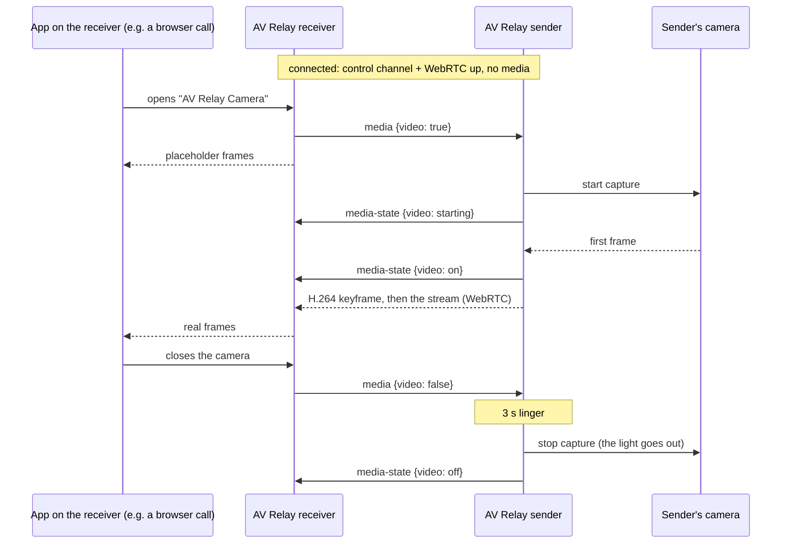

# Architecture

AV Relay makes one computer's camera and microphone show up on another
computer as a regular webcam and microphone. The computer with the devices
runs the **sender** (the server); the one that uses them runs the
**receiver** (the client). Today the sender is a macOS app and the receiver
a Linux app; the protocol (`docs/protocol.md`) is platform-neutral, so other
senders and receivers can follow.

## Repository layout

```
server/macos/        the sender for macOS (Swift, menu bar)
client/linux/        the receiver for Linux (Rust, tray), packaged as .deb
client/windows/      notes only, no code yet (README.md)
docs/                protocol.md (source of truth), architecture.md, user docs
tests/vectors/       shared crypto test vectors + their generator
assets/              logo script and the icons it generates
.github/workflows/   build, test, release
```

## The whole picture

```
┌────────── sender (server): macOS app ─────────────────┐        ┌────────── receiver (client): Linux app ─────────┐
│ menu bar UI: Allow Pairing (code), devices, status    │        │ tray: Pair with a sender…, status, Forget       │
│                                                       │        │                                                 │
│ control server (TCP 48100) ◄── Noise IK, JSON ─────────────────── control client ── reconnect (last IP, mDNS)    │
│   pairing: CPace + Noise XXpsk3                       │        │   pairing: CPace + Noise XXpsk3                 │
│   Bonjour _avrelay._tcp  id=<device id>               │        │                                                 │
│                                                       │        │ device watcher: is anyone using cam / mic?      │
│ capture on demand                                     │        │   → media {video, audio}                        │
│   AVCaptureSession (camera)  ─┐                       │        │                                                 │
│   microphone capture         ─┤ libwebrtc             │  UDP   │ GStreamer webrtcbin                             │
│                               └► H.264 (VideoToolbox) ═══════════► H.264 decode ─► scale ─► v4l2loopback         │
│                                  Opus (in-band FEC)   │ DTLS-  │   "AV Relay Camera"                             │
│                                  GCC, pacing, RTX     │ SRTP   │ Opus decode ─► PipeWire Audio/Source            │
│                                                       │        │   "AV Relay Microphone" (the default input)     │
└───────────────────────────────────────────────────────┘        └─────────────────────────────────────────────────┘
```

## Decisions and why

**Transport: WebRTC.** Wi-Fi drops and delays packets in bursts. Real-time
media over it needs retransmission (NACK/RTX), keyframe requests (PLI), a
jitter buffer, and congestion control that backs off before the Wi-Fi queue
fills (GCC on transport-wide feedback). WebRTC has all of these, mature and
tested, in libwebrtc on the sender and GStreamer's `webrtcbin` on the
receiver. Hand-rolled RTP, SRT or QUIC would mean rebuilding the sender half.
WebRTC's discovery machinery (ICE) is reduced to host candidates on the LAN,
and its signaling runs over our own authenticated channel.

**Video: H.264.** Senders encode it in hardware (the macOS sender with
VideoToolbox: low latency, no B-frames), and every receiver can decode it.
The Linux receiver decodes in software (libavcodec): 1080p30 is cheap for any
recent CPU, and it behaves the same on every machine, with no GPU driver
involved and no discrete GPU woken. VP8, VP9 and AV1 would be
software-encoded on a Mac, and HEVC is not a WebRTC baseline codec.

**Audio: Opus**, mono 48 kHz, 20 ms frames, in-band FEC: the standard for
real-time voice, built into libwebrtc and GStreamer. The sender's echo
cancellation, gain control and noise suppression are off: the conferencing
app on the receiver runs its own and has the far-end signal.

**Control channel: Noise over TCP.** Noise_IK with the static keys from
pairing gives mutual authentication and forward secrecy with no
certificates or keychain identities, in a few hundred lines on each side,
checked against shared vectors. It carries SDP, ICE candidates and the
on-demand requests, and because the SDP is authenticated, so is DTLS.

**Pairing: CPace, then Noise XXpsk3.** The 6-digit code has ~20 bits of
entropy. CPace (a CFRG PAKE) turns it into a strong shared key without
allowing offline guessing; Noise XXpsk3 keyed by that swaps the static keys
and confirms both sides typed the same code. Details: protocol section 5.

**All connections start at the receiver.** The sender listens; the receiver
connects to it (TCP), and ICE's connectivity checks open the receiver's
firewall for media, so the receiver needs no inbound rule.

## Sender: the macOS app (`server/macos/`)

A menu bar app (no Dock icon) in Swift. Deployment target macOS 14.

| part | job |
|---|---|
| Identity | X25519 static key, device ID, the list of paired receivers: files in `~/Library/Application Support/AV Relay/` (folder 0700, key 0600), like an SSH key. Not the Keychain: ad-hoc signed updates change the app's signature, and the Keychain would ask the user to allow access again after each update. |
| Pairing | the window: code, countdown, addresses; CPace (libsodium's ristretto255) + Noise XXpsk3 |
| Noise | Noise_IK / XXpsk3 on CryptoKit (X25519, ChaChaPoly, SHA-256), tested against `tests/vectors` |
| `avrelay-devserver` | the same server headless: for interop tests (`tests/interop/reference_client.py`) and for developing a receiver; `--media test` runs the real media engine with a test pattern and tone |
| Control server | `NWListener` on TCP 48100: framing, preamble, one session at a time, keepalive |
| Bonjour | advertises `_avrelay._tcp` with TXT `v=1`, `id=` |
| Media engine | libwebrtc peer connection (offerer): H.264 (VideoToolbox) and Opus only, both m-sections negotiated once, one offer at a time; GCC, pacing and RTX built in |
| Camera | `AVCaptureSession` into libwebrtc's video source: the smallest camera mode that covers the requested format, scaled to it exactly |
| Microphone | AV Relay's own libwebrtc audio device: captures the chosen microphone (the built-in one unless the user picks another) and nothing is played out; echo cancellation, gain control and noise suppression off |
| Sleep | IOKit power notifications: before sleep the session ends (bye `sleep`), sessions are refused until the wake, and the sleep is acknowledged only once the camera and microphone are closed |
| Menu | *Enable AV Relay* (off: as if quit, remembered), status (connected receiver, camera/mic in use), *Allow Pairing…*, paired devices (remove), camera/mic choice, Open at Login, Settings (port), quit |

**On demand without renegotiation.** A kind turns on by resuming its
sender's encoding and off (3 seconds after the receiver stops using it) by
pausing it. Pausing the audio sender makes libwebrtc stop recording, which
closes the microphone; resuming the video sender restarts the encoder, so
the first frame is a keyframe.

**Starting at full quality.** libwebrtc caps an H.264 encoder's frame rate
to what the negotiated level allows, and a receiver's answer may simply echo
level 3.1 (1080p at about 13 fps), so the encoder runs at level 5.1, which
every receiver must decode (protocol section 8.2). The bandwidth estimate
starts at half the format's cap instead of libwebrtc's ~300 kbit/s, which
would also make it start 1080p at a lower resolution; GCC still backs off
if the Wi-Fi can't carry it.

**Testing the real devices.** Only an app bundle may open the camera and
microphone, so the app has a self-test (`--self-test`) that sends both
through capture, encoding, WebRTC and decoding in one process; see
`server/macos/README.md`. While a call runs, a stats line every 5 s (WebRTC
stats and the devices' own cadence) goes to the system log.

Camera and microphone access are asked for the first time they're needed
(macOS shows its permission prompt then). While a device is off, the app
holds nothing open, so the camera light and microphone indicator stay off.

**libwebrtc** comes as a prebuilt `WebRTC.xcframework` through Swift Package
Manager, pinned by version and checksum; the version is recorded in the
package manifest. libsodium comes the same way.

**Signing.** Releases are ad-hoc signed (no Apple Developer ID). The first
launch needs *System Settings → Privacy & Security → Open Anyway*, and
macOS asks for camera and microphone permission again after each update,
because the permission is tied to the app's signature.

## Receiver: the Linux app (`client/linux/`)

A tray app in Rust, shipped as a `.deb` for Ubuntu 24.04. `docs/linux.md`
has the details; this is the shape.

| part | job |
|---|---|
| Tray | StatusNotifierItem (`ksni`; Ubuntu's dock shows it): *Enable AV Relay*, status, *Pair with a sender…*, *Forget*, camera quality, *Keep virtual devices on*, *Start at login*, *Start minimized*, quit |
| Pair dialog | GTK4: the sender's address and port first (or one found on the network), then the 6-digit code |
| Control client | framing, Noise (`snow`), CPace (`curve25519-dalek`), keepalive, reconnect (last address, then Bonjour) |
| Media | GStreamer `webrtcbin` (answerer): H.264 decode → scale/convert → virtual camera; Opus decode → virtual microphone. Both sinks synchronized: everything renders at capture time plus one playout delay (both jitter buffers' latency, set from the spread of arrival minus RTP time over the last minute, 0.2-2 s), lined up by RTCP lip-sync |
| Virtual camera | a `v4l2loopback` device named "AV Relay Camera" (`/dev/video48` when free), with exclusive caps: apps list it only while AV Relay writes to it. A waiting picture until the sender's first frame. Needs v4l2loopback 0.13 or newer for the client-usage event. |
| Virtual microphone | a PipeWire `Audio/Source` node, "AV Relay Microphone" |
| Device watcher | sees when an app opens the camera (v4l2loopback's client-usage event) or records from the microphone (the PipeWire node starts running), and sends `media` |
| Defaults | below |

### The devices and the default input

- **While a sender is connected**, the two virtual devices exist and "AV
  Relay Microphone" is the default input (the previous default is saved on
  disk first, so a crash or power loss is repaired at the next start).
- **When it goes away**, they stay for 5 minutes, the camera showing a
  "Waiting for connection…" picture and the microphone silence, so a short drop goes
  unnoticed by apps. Then they go, and the previous default input comes
  back. *Keep virtual devices on* keeps them for as long as AV Relay runs.
- **Camera.** Linux has no system-wide default camera; each app picks its
  own and remembers it by name, which is why the name is fixed. Apps that
  open cameras directly see it; apps that only use PipeWire's camera portal
  don't yet.

## On demand, end to end



## Building and releasing

GitHub Actions tests and builds both apps when their code changes on main or
in a pull request (the macOS one also on demand, as macOS runner minutes
are costly). Both are released together with one version:
`scripts/release.py X.Y.Z` moves the changelog's entries under the version,
sets it in the Linux package and tags `vX.Y.Z`; pushing the tag checks that
they agree, builds both, and publishes a GitHub Release with the changelog's
section as its notes (docs/releasing.md):

- **macOS sender** (macOS runner): test, build the app for Apple silicon and
  Intel, ad-hoc sign it, publish `AV-Relay-<version>-macOS.zip` and `.dmg`.
- **Linux receiver** (`ubuntu-24.04` runner): test, build the Rust app and
  the `.deb` (dependencies include GStreamer's WebRTC plugins and
  v4l2loopback 0.13+; Ubuntu 24.04's own `v4l2loopback-dkms` is 0.12.7, which
  is too old, so the package and the app check the version and say what to
  install).
- Both run their unit tests, including the `tests/vectors` checks, before
  packaging.

## Tested on

Ubuntu 24.04 and a MacBook Air (M4) with macOS 27, over Wi-Fi.

## Windows (not started)

`client/windows/README.md` holds the notes for a Windows receiver: a virtual
camera through Windows 11's `MFCreateVirtualCamera` (user mode, free), and
microphone options that don't need a paid driver signature. Nothing is
implemented; the protocol is ready for it.
