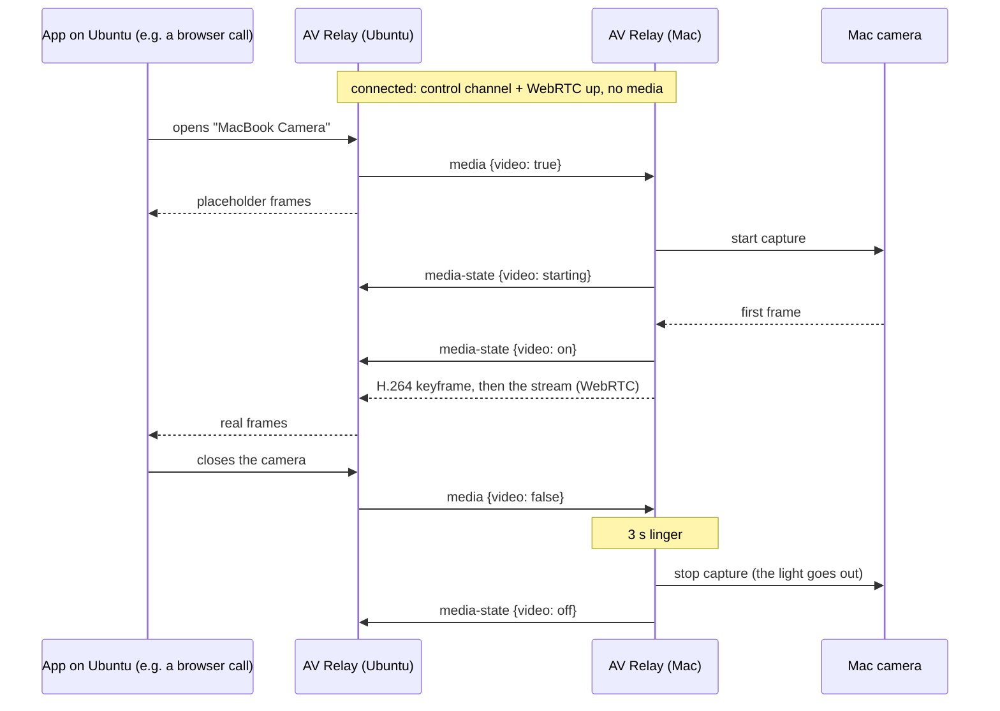

# Architecture

AV Relay makes a MacBook's camera and microphone show up on another
computer as a regular webcam and microphone. The Mac runs the **server**; the
other computer runs a **client**. Today that's Ubuntu; the protocol
(`docs/protocol.md`) has nothing Linux-specific in it, so other clients can
follow.

## Repository layout

```
server/macos/        the Mac app (Swift, menu bar)
client/linux/        the Linux app (Rust, tray), packaged as .deb
client/windows/      notes only, no code yet (README.md)
docs/                protocol.md (source of truth), architecture.md, user docs
tests/vectors/       shared crypto test vectors + their generator
assets/              logo script and the icons it generates
.github/workflows/   build, test, release
```

## The whole picture

```
┌──────────────────── Mac (server) ─────────────────────┐        ┌──────────────── Ubuntu (client) ────────────────┐
│ menu bar UI: Allow pairing (code), devices, status    │        │ tray: Pair device…, status, Forget              │
│                                                       │        │                                                 │
│ control server (TCP 48100) ◄── Noise IK, JSON ─────────────────── control client ── reconnect (last IP, mDNS)   │
│   pairing: CPace + Noise XXpsk3                       │        │   pairing: CPace + Noise XXpsk3                 │
│   Bonjour _avrelay._tcp  id=<device id>               │        │                                                 │
│                                                       │        │ device watcher: is anyone using cam / mic?      │
│ capture on demand                                     │        │   → media {video, audio}                        │
│   AVCaptureSession (camera)  ─┐                       │        │                                                 │
│   microphone capture         ─┤ libwebrtc            │  UDP   │ GStreamer webrtcbin                             │
│                               └► H.264 (VideoToolbox) ═══════════► H.264 decode ─► scale ─► v4l2loopback      │
│                                  Opus (in-band FEC)   │ DTLS-  │   "MacBook Camera" (exists while connected)     │
│                                  GCC, pacing, RTX     │ SRTP   │ Opus decode ─► PipeWire Audio/Source            │
│                                                       │        │   "MacBook Microphone" (default while connected)│
└───────────────────────────────────────────────────────┘        └─────────────────────────────────────────────────┘
```

## Decisions and why

**Transport: WebRTC.** Wi-Fi drops and delays packets in bursts. Real-time
media over it needs retransmission (NACK/RTX), keyframe requests (PLI), a
jitter buffer, and congestion control that backs off before the Wi-Fi queue
fills (GCC on transport-wide feedback). WebRTC has all of these, mature and
tested, in libwebrtc on the sender and GStreamer's `webrtcbin` on the
receiver. Hand-rolled RTP, SRT or QUIC would mean rebuilding the sender half.
WebRTC's discovery machinery (ICE) is reduced to host candidates on the LAN,
and its signaling runs over our own authenticated channel.

**Video: H.264.** The Mac encodes it in hardware with VideoToolbox (low
latency, no B-frames), and every Linux machine decodes it, in hardware
(VA-API, NVDEC) or software (libavcodec). VP8, VP9 and AV1 would be
software-encoded on the Mac, and HEVC is not a WebRTC baseline codec.

**Audio: Opus**, mono 48 kHz, 20 ms frames, in-band FEC: the standard for
real-time voice, built into libwebrtc and GStreamer. The Mac's echo
cancellation, gain control and noise suppression are off: the conferencing
app on the client runs its own and has the far-end signal.

**Control channel: Noise over TCP.** Noise_IK with the static keys from
pairing gives mutual authentication and forward secrecy with no
certificates or keychain identities, in a few hundred lines on each side,
checked against shared vectors. It carries SDP, ICE candidates and the
on-demand requests, and because the SDP is authenticated, so is DTLS.

**Pairing: CPace, then Noise XXpsk3.** The 6-digit code has ~20 bits of
entropy. CPace (a CFRG PAKE) turns it into a strong shared key without
allowing offline guessing; Noise XXpsk3 keyed by that swaps the static keys
and confirms both sides typed the same code. Details: protocol section 5.

**All connections start at the client.** The Mac listens; the client
connects to it (TCP), and ICE's connectivity checks open the client's
firewall for media, so Ubuntu needs no inbound rule.

## Mac server (`server/macos/`)

A menu bar app (no Dock icon) in Swift. Deployment target macOS 14.

| part | job |
|---|---|
| Identity | X25519 static key in the Keychain; device ID; the list of paired clients |
| Pairing | the window: code, countdown, addresses; CPace (libsodium's ristretto255) + Noise XXpsk3 |
| Noise | Noise_IK / XXpsk3 on CryptoKit (X25519, ChaChaPoly, SHA-256), tested against `tests/vectors` |
| Control server | `NWListener` on TCP 48100: framing, preamble, one session at a time, keepalive |
| Bonjour | advertises `_avrelay._tcp` with TXT `v=1`, `id=` |
| Media engine | libwebrtc peer connection (offerer): H.264 via VideoToolbox, Opus, GCC/pacing/RTX built in |
| Capture | camera through `AVCaptureSession` into a libwebrtc video source, started and stopped on demand; microphone the same way, with audio processing off |
| Menu | status (connected device, camera/mic in use), *Allow pairing…*, paired devices (remove), camera/mic choice, port, quit |

Camera and microphone access are asked for the first time they're needed
(macOS shows its permission prompt then). While a device is off, the app
holds nothing open, so the camera light and microphone indicator stay off.

**libwebrtc** comes as a prebuilt `WebRTC.xcframework` through Swift Package
Manager, pinned by version and checksum; the version is recorded in the
package manifest. libsodium comes the same way.

**Signing.** Releases are ad-hoc signed (no Apple Developer ID). The first
launch needs *System Settings → Privacy & Security → Open Anyway*, and
macOS asks for camera and microphone permission again after each update,
because the permission is tied to the app's signature.

## Linux client (`client/linux/`)

A tray app in Rust, shipped as a `.deb` for Ubuntu 24.04. The Linux side
owns the details below; this is the agreed shape.

| part | job |
|---|---|
| Tray | StatusNotifierItem (`ksni`; Ubuntu's dock shows it): status, *Pair device…*, *Forget this Mac*, quit |
| Pair dialog | GTK4: IP and port first, then the 6-digit code |
| Control client | framing, Noise (`snow`), CPace (`curve25519-dalek`), keepalive, reconnect (last address, then Bonjour via Avahi) |
| Media | GStreamer `webrtcbin` (answerer): H.264 decode → scale/convert → virtual camera; Opus decode → virtual microphone |
| Virtual camera | a `v4l2loopback` device named "MacBook Camera" (`/dev/video48` when free), created at startup through v4l2loopback's control device, with exclusive caps: apps list it only while AV Relay writes to it, i.e. while the Mac is connected. Placeholder frames until the Mac's first frame arrives. Needs v4l2loopback 0.13 or newer for the client-usage event. |
| Virtual microphone | a PipeWire `Audio/Source` node, "MacBook Microphone" |
| Device watcher | sees when an app opens the camera (v4l2loopback's client-usage event) or records from the microphone (the PipeWire node starts running), and sends `media` |
| Defaults | below |

### Defaults on Ubuntu

- **Microphone.** When the Mac connects, the app saves the current default
  input and makes "MacBook Microphone" the default; when the Mac goes away,
  it restores the saved one (if it still exists). The saved value is kept on
  disk, so a crash or power loss is repaired at the next start.
- **Camera.** Linux has no system-wide default camera; each app picks its
  own. AV Relay doesn't hide the built-in camera (that would need root). It
  makes "MacBook Camera" exist only while the Mac is connected and marks it
  as PipeWire's preferred video source, so apps that use PipeWire's camera
  portal pick it, and others list it by name.

## On demand, end to end



## Building and releasing

GitHub Actions builds both apps on every push and attaches them to a GitHub
Release on every `v*` tag:

- **macOS** (macOS runner): build the app, ad-hoc sign it, publish
  `AV-Relay-<version>-macOS.zip` and `.dmg`.
- **Linux** (`ubuntu-24.04` runner): build the Rust app and the `.deb`
  (dependencies include GStreamer's WebRTC plugins and v4l2loopback 0.13+;
  Ubuntu 24.04's own `v4l2loopback-dkms` is 0.12.7, which is too old, so the
  package and the app check the version and say what to install).
- Both run their unit tests, including the `tests/vectors` checks, before
  packaging.

## Tested on

Ubuntu 24.04 and a MacBook Air (M4) with macOS 27, over Wi-Fi.

## Windows (not started)

`client/windows/README.md` holds the notes: a virtual camera through
Windows 11's `MFCreateVirtualCamera` (user mode, free), and microphone
options that don't need a paid driver signature. Nothing is implemented;
the protocol is ready for it.
