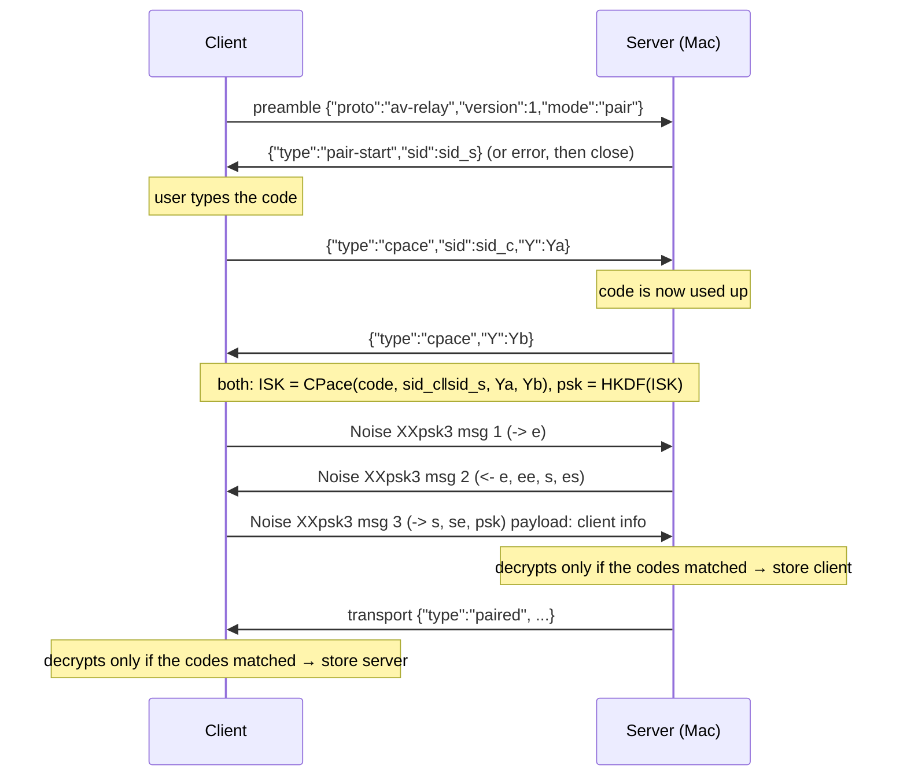
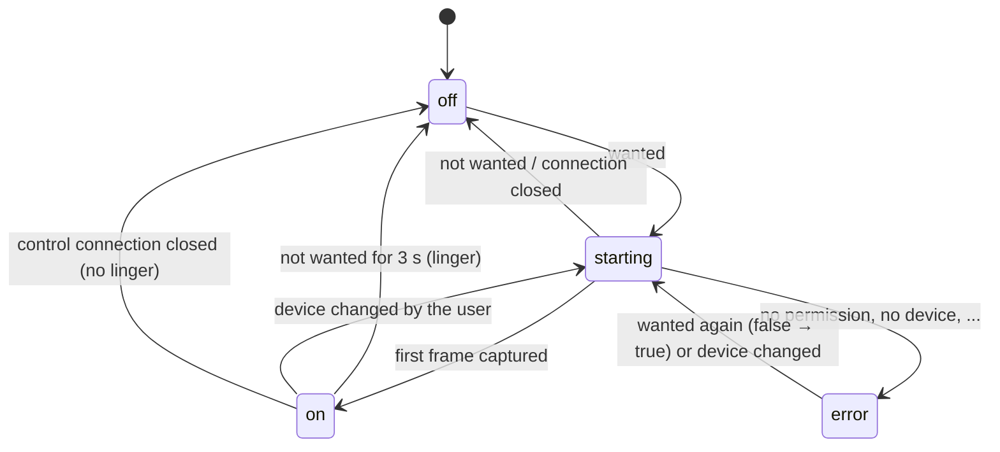

# AV Relay protocol, version 1

This document is the source of truth for how the Mac app (the **server**) and
a client app (the **client**; today the Linux app) talk to each other. Both
implementations follow it, and a change to the protocol lands here first and
is reviewed by the other side. Nothing in it is specific to Linux, so other
clients (see `client/windows/README.md`) can plug in later.

The key words MUST, SHOULD and MAY are used as in RFC 2119.

## Contents

1. [Overview](#1-overview)
2. [Identities and keys](#2-identities-and-keys)
3. [Finding the server](#3-finding-the-server)
4. [Connections, framing and the preamble](#4-connections-framing-and-the-preamble)
5. [Pairing](#5-pairing)
6. [Session](#6-session)
7. [Control messages](#7-control-messages)
8. [Media (WebRTC)](#8-media-webrtc)
9. [Camera and microphone on demand](#9-camera-and-microphone-on-demand)
10. [Liveness and reconnecting](#10-liveness-and-reconnecting)
11. [Errors](#11-errors)
12. [Security considerations](#12-security-considerations)
13. [Test vectors](#13-test-vectors)

## 1. Overview

```
 Mac (server)                                        client (e.g. Ubuntu)
 ────────────                                        ────────────────────
 TCP 48100  ◄──── control: Noise-encrypted JSON ────  connects with IP:port
            ────  pairing once (6-digit code)    ────
 WebRTC     ════ media: H.264 + Opus over ═══════►  virtual camera + mic
            ════ DTLS-SRTP, UDP, ICE (LAN)  ═════
```

- The **server** runs on the Mac. It owns the camera and microphone, listens
  on TCP port **48100** (configurable) and advertises itself over Bonjour.
- The **client** connects to it. The first time, the user pairs it with a
  6-digit code shown on the Mac. After that the two reconnect on their own.
- One TCP connection, the **control channel**, carries everything except
  media: WebRTC signaling (SDP and ICE candidates) and the client's requests
  to turn the camera and microphone on or off. It is encrypted and mutually
  authenticated with the keys exchanged at pairing (Noise).
- **Media** flows over a WebRTC peer connection set up through the control
  channel: H.264 video and Opus audio, sent by the Mac, received by the
  client. The control channel authenticates the SDP, and with it the DTLS
  fingerprints, so the media is end-to-end protected by the same pairing.
- The camera and microphone run **only while an app on the client uses
  them**: the client says what it needs, and the Mac starts or stops capture.

## 2. Identities and keys

Each installation (each Mac, each client) has one long-term **static key**:
an X25519 key pair, generated on first start and kept until the user resets
the app. It is the device's identity for pairing and sessions.

- The **device ID** is the first 8 bytes of SHA-256 over the 32-byte static
  public key, as 16 lowercase hex digits. It is not secret. Example:
  `pairing.json` → `device_id`.
- After pairing, the server keeps a list of paired clients (static public
  key, name, device ID, time paired); the client keeps the paired server
  (static public key, name, device ID, last address and port).
- The static private key MUST be stored readable only by the user (the
  macOS Keychain on the Mac; a mode 0600 file or the Secret Service on
  Linux). Public data (paired devices) MAY be stored in plain files.

## 3. Finding the server

- The server listens on TCP **48100** by default, on all interfaces. The
  user can change the port on the Mac.
- The server advertises a Bonjour (DNS-SD) service: type `_avrelay._tcp`,
  the listening port, instance name = the Mac's name as the user set it,
  and TXT records `v=1` and `id=<device ID>`.
- Pairing always starts from an address the user types (IP and port), as
  shown in the Mac's pairing window. Bonjour is only used to find a
  **paired** Mac again when its address changes (DHCP): the client looks for
  an `_avrelay._tcp` instance whose `id` matches the paired device ID.

## 4. Connections, framing and the preamble

Every connection is a TCP connection from the client to the server, used
for exactly one of two **modes**: `pair` or `session`.

**Framing.** Every message on the connection, in both directions, is a
**frame**: a 2-byte big-endian length, then that many bytes of payload
(at most 65535). A Noise message is always exactly one frame.

**Preamble.** The first frame from the client is a plaintext JSON object:

```json
{"proto": "av-relay", "version": 1, "mode": "pair"}
```

`mode` is `pair` or `session`. The server:

- closes the connection if the frame isn't such an object, if `proto`
  isn't `av-relay`, or if the preamble hasn't arrived within 10 seconds;
- answers a `version` it doesn't speak with a plaintext
  `{"type": "error", "code": "unsupported-version", "versions": [1]}` and
  closes;
- otherwise continues with the mode's exchange below.

**Plaintext JSON.** Before Noise starts, messages are plaintext UTF-8 JSON
objects; frames of more than 1024 bytes are an error (close). Binary values
are base64 (RFC 4648, standard alphabet, with padding).

## 5. Pairing

Pairing turns a 6-digit code, which the user reads on the Mac and types on
the client, into an exchange of the two static public keys. A 6-digit code
has only ~20 bits of entropy, so it is never used as a key directly: it goes
through **CPace**, a balanced PAKE (draft-irtf-cfrg-cpace-21, suite
CPACE-RISTR255-SHA512), which gives an attacker one guess per attempt and
nothing to brute-force offline. The CPace output then keys a **Noise
XXpsk3** handshake that carries the static keys and confirms that both
sides used the same code.

### 5.1 The pairing window on the Mac

- The user opens it (menu bar → *Allow pairing…*). Only a person at the Mac
  can open it; nothing on the network can.
- The server draws a code: a uniform random integer 0–999999 from the system
  CSPRNG, written as 6 ASCII digits with leading zeros (`042137`). It shows
  it as `042 137`, with the Mac's addresses and port, and a countdown.
- The window is open for **120 seconds** (or until the user closes it).
- **One attempt per code.** The code is used up when the server receives the
  client's `cpace` message, whatever happens next. After a failed attempt
  the Mac says so, and the user opens the window again for a new code.
- While an attempt is in progress, other pairing connections get
  `{"type": "error", "code": "busy"}`; when no window is open, they get
  `{"type": "error", "code": "not-pairing"}`. Both are plaintext, then the
  server closes.
- A successful pairing closes the window.

### 5.2 Exchange



1. The client sends the preamble with `"mode": "pair"`.
2. If a pairing window is open and idle, the server answers
   `{"type": "pair-start", "sid": <16 random bytes>}` (`sid_s`).
   The client asks the user for the code now if it hasn't already (it MAY
   ask first; the code is only needed from step 3 on).
3. The client draws `sid_c` (16 random bytes) and its CPace scalar, and
   sends `{"type": "cpace", "sid": <sid_c>, "Y": <Ya, 32 bytes>}`.
4. The server marks the code used, draws its scalar, and sends
   `{"type": "cpace", "Y": <Yb, 32 bytes>}`.
5. Both compute the ISK (5.3) and then `psk`, and run Noise (5.4).
6. The server, once message 3 decrypts, stores the client (static key from
   the handshake, name from the payload) and sends `paired`.
7. The client, once `paired` decrypts, stores the server (static key from
   the handshake, name, device ID, and the address and port it used).
8. Both close the connection. The client then opens a session (section 6).

Any failure after step 4 (a bad point, Noise decryption failing, a timeout,
the connection dropping) ends the attempt: both sides close, store nothing,
and tell the user. On the client: *"Pairing failed. Check the code and try
again; the Mac shows a new code each time."* The whole exchange MUST finish
within 60 seconds of the preamble (it waits on the user typing the code).

### 5.3 CPace parameters

CPace exactly as in draft-irtf-cfrg-cpace-21 (sections 7 and 8.3), with
G = ristretto255 and H = SHA-512, in the **initiator-responder** setting:
the client is the initiator (A), the server the responder (B).

| Input | Value |
|---|---|
| `PRS` | the code as 6 ASCII digits, e.g. `b"042137"` (no space) |
| `CI` | `lv_cat(b"av-relay/1 pairing", b"client", b"server")` |
| `sid` | `sid_c ‖ sid_s` (32 bytes) |
| `ADa`, `ADb` | empty |

- Generator: `g = element_derivation(SHA-512(generator_string(DSI, PRS, CI, sid, 128)))`
  with `DSI = b"CPaceRistretto255"`; with libsodium,
  `crypto_core_ristretto255_from_hash`.
- Scalars: 32 random bytes with the top 4 bits cleared (`y[31] &= 0x0f`),
  never reused.
- `Ya = encode(ya·g)`, `Yb = encode(yb·g)`.
- `K = scalar_mult_vfy(y, Y_peer)`: decode the peer's point and multiply. A
  peer point that doesn't decode, or a `K` that is the identity, MUST abort
  the attempt. (libsodium's `crypto_scalarmult_ristretto255` returns -1 in
  both cases.)
- `ISK = SHA-512(lv_cat(b"CPaceRistretto255_ISK", sid, K) ‖ lv_cat(Ya, ADa) ‖ lv_cat(Yb, ADb))`.
- `psk = HKDF-SHA256(salt = empty, IKM = ISK, info = b"av-relay/1 pairing psk", L = 32)`.

`lv_cat` prepends each argument's length (LEB128) to it; see the draft's
appendix A. Each role is fixed (the Mac is always the responder), so the
roles in `CI` rule out reflection and role confusion.

### 5.4 Noise for pairing

- Protocol: `Noise_XXpsk3_25519_ChaChaPoly_SHA256` (Noise revision 34),
  client = initiator.
- Prologue: `b"av-relay/1 pair" ‖ sid ‖ Ya ‖ Yb` (15 + 32 + 32 + 32 bytes).
- PSK: `psk` from 5.3.
- Payloads: message 1 and 2 empty; message 3 the client info,
  `{"name": "<client device name>", "app": "<app name and version>"}`.
- After the handshake the server sends one transport message:

```json
{"type": "paired", "name": "<Mac name>", "device_id": "<server device ID>", "app": "AV Relay 0.1.0 macOS"}
```

Message 3 and every transport message depend on the psk, so the server
learns at message 3, and the client at `paired`, that the other side used
the same code. A wrong code fails exactly there, with nothing learned that
helps a second guess.

Pairing a client that is already paired replaces its entry (new name).
Pairing does not affect other paired clients.

## 6. Session

Every later connection is a session: a mutually authenticated, encrypted
control channel between a paired client and the server.

- Preamble: `{"proto": "av-relay", "version": 1, "mode": "session"}`.
- Noise: `Noise_IK_25519_ChaChaPoly_SHA256`, client = initiator, with the
  server's static key from pairing as the initiator's pre-known remote key.
- Prologue: `b"av-relay/1 session"`.
- Handshake payloads: empty.
- The handshake MUST complete within 10 seconds of the preamble.

Then every frame is one Noise transport message carrying one control
message (section 7).

**Unknown client.** IK carries the client's static key in message 1. If it
isn't in the server's paired list, the server still completes the handshake,
sends `{"type": "error", "code": "not-paired"}` and closes. The client then
tells the user the Mac no longer knows this device and offers to pair again.
If the server can't decrypt message 1 at all (the client holds a stale server
key, e.g. after the Mac app was reset), it closes; the client shows *"Couldn't
authenticate the Mac. If AV Relay was reset on the Mac, pair again."*

**Authenticated only at `hello`.** Anyone on the network can record and
replay a client's message 1, and the server can't tell a replay apart:
message 1 proves nothing until the sender shows it holds the matching
ephemeral key. So a session counts as authenticated only once its first
transport message, which MUST be `hello`, decrypts. Until then the server
changes nothing (no `replaced`, no `busy`), and a connection that doesn't
send a valid `hello` within the handshake timeout is closed.

**One session at a time.** A server serves one client at a time. Once a
new session is authenticated, if the same client already has a session,
the new one replaces it (the old one gets `bye` with reason `replaced`); if
another client has one, the new session gets
`{"type": "error", "code": "busy"}` and is closed.

## 7. Control messages

Each control message is one JSON object (UTF-8) in one Noise transport
message. It has a `type`; receivers MUST ignore unknown types and unknown
fields. Binary values are base64.

### Client → server

| type | fields | meaning |
|---|---|---|
| `hello` | `name`, `app`, `video: {width, height, fps}` | First message of a session. `video` is the format the client wants (it owns the virtual camera's format), e.g. `1280×720@30`. |
| `answer` | `sdp` | SDP answer to the server's latest `offer`. |
| `ice` | `candidate`, `sdpMid`, `sdpMLineIndex` | A local ICE candidate (8.4). `candidate: ""` = end of candidates. |
| `media` | `video: bool`, `audio: bool` | What the client needs right now (section 9). Sent after `hello` and on every change. |
| `ice-restart` | – | Asks the server for a new offer with an ICE restart (e.g. the client's network changed). |
| `ping` | `id` (integer) | Keepalive (section 10). |
| `unpair` | – | The user removed this Mac on the client. The server deletes this client from its paired list, sends `bye` (`unpaired`) and closes. |
| `bye` | `reason` | The client is closing (`quit`). |

### Server → client

| type | fields | meaning |
|---|---|---|
| `welcome` | `name`, `app`, `device_id` | Answer to `hello`. The server sends its first `offer` right after it. |
| `offer` | `sdp` | SDP offer. The server is always the offerer; it MAY send a new one at any time. |
| `ice` | `candidate`, `sdpMid`, `sdpMLineIndex` | As above. |
| `media-state` | `video: {...}`, `audio: {...}` | The state of capture (section 9). Sent after `welcome` and on every change. |
| `pong` | `id` | Answer to `ping`, same `id`. |
| `bye` | `reason` | The server is closing: `quit`, `unpaired` (the user removed this client on the Mac), `replaced`. |
| `error` | `code`, `message` | Section 11. |

`media-state` objects:

```json
{"type": "media-state",
 "video": {"state": "on", "device": "FaceTime HD Camera", "width": 1280, "height": 720, "fps": 30},
 "audio": {"state": "error", "device": "MacBook Air Microphones", "error": "permission-denied"}}
```

`state` is one of `off`, `starting`, `on`, `error`; `device` is the
user-facing name of the camera or microphone the Mac will use; `error`
(with `state: "error"`) is one of `permission-denied`, `no-device`,
`device-busy`, `failed`.

Example session start (the JSON texts in the vectors are compact; any JSON
encoding of the same object is fine):

```mermaid
sequenceDiagram
    participant C as Client
    participant S as Server (Mac)
    C->>S: preamble {"mode":"session"}
    C->>S: Noise IK msg 1
    S->>C: Noise IK msg 2
    C->>S: hello {name, app, video}
    S->>C: welcome {name, app, device_id}
    S->>C: offer {sdp}
    S->>C: media-state {video: off, audio: off}
    C->>S: answer {sdp}
    C->>S: media {video: false, audio: false}
    C-->>S: ice ... (both ways, trickle)
    Note over C,S: ICE + DTLS connect; no media until wanted
```

## 8. Media (WebRTC)

### 8.1 Roles and negotiation

- The server is always the **offerer** and the client always the
  **answerer**, so offers never collide. The client asks for a new offer
  with `ice-restart` when it needs one.
- The first offer follows `welcome`. It has two m-sections, both
  `sendonly` from the server, in this order: **video**, then **audio**.
  Both are present from the first offer whether or not the camera or mic
  is in use, so turning one on needs no renegotiation.
- `a=group:BUNDLE` with both (max-bundle) and `a=rtcp-mux` are required.
- The client answers `recvonly` for both.
- The client MUST accept a new offer at any time (re-negotiation, ICE
  restart, a changed direction) and answer it.
- No data channels.

### 8.2 Codecs

**Video: H.264** (encoded in hardware on the Mac by VideoToolbox).
- `packetization-mode=1`, Constrained High or Constrained Baseline profile,
  no B-frames.
- The client MUST decode up to level 5.1 and SHOULD answer with
  `level-asymmetry-allowed=1`, so 1080p30 fits whatever level the offer
  lists.
- RTX (`rtx`, `apt=`) and RTCP feedback `nack`, `nack pli`, `ccm fir`,
  `transport-cc` are offered; the client SHOULD keep them in its answer.
- The client MUST handle resolution changes mid-stream (the encoder may
  scale down under congestion); it scales to its fixed virtual camera
  format.

**Audio: Opus**, `opus/48000/2` with `minptime=10;useinbandfec=1`, mono
(`stereo=0`), 20 ms frames, no DTX. The Mac's own echo cancellation, gain
control and noise suppression are **off** by default: the app on the
client side runs its own, and it has the far-end reference.

**Header extensions:** `urn:ietf:params:rtp-hdrext:sdes:mid`,
`http://www.ietf.org/id/draft-holmer-rmcat-transport-wide-cc-extensions-01`,
`http://www.webrtc.org/experiments/rtp-hdrext/abs-send-time`. The client
SHOULD keep transport-cc: it drives the server's congestion control (GCC),
which adapts the bitrate to the Wi-Fi.

**Bitrate.** The server caps video at 4 Mbit/s for 720p30 and 8 Mbit/s for
1080p30 (scaled by pixel rate for other formats), floor 300 kbit/s. The
call app on the client re-encodes our stream, so we start from a clean
picture; GCC still backs off when the Wi-Fi can't carry it. Opus runs at
about 40 kbit/s.

### 8.3 Format

The client asks for the virtual camera's format in `hello.video`. The server
picks the camera format closest to it (at least as large, same aspect ratio
if possible), scales to exactly the requested size, and caps the frame rate
at `fps`. It reports what it actually sends in `media-state.video`.

### 8.4 ICE and DTLS

- No STUN or TURN servers: host candidates only, UDP only.
- Each side SHOULD only signal candidates on the address of its own end of
  the control connection (its TCP socket's local address), so media takes
  the path the user chose, not a VPN or container interface. IPv6
  link-local candidates are not signaled.
- Candidates are trickled with `ice` messages as they are gathered.
- DTLS-SRTP as in WebRTC (RFC 8827): each side verifies the peer's DTLS
  certificate against the `a=fingerprint` in the SDP it received. That SDP
  came over the authenticated control channel, so only the paired peer can
  complete DTLS. Certificates MAY be fresh per session.

## 9. Camera and microphone on demand

The client watches its virtual devices and tells the server, in `media`,
what is in use **right now** (a level, not an event): `video` is true while
any app has the virtual camera open for capture, `audio` while any app
records from the virtual microphone.



- **Start at once.** On `media` with a kind `true`, the server MUST start
  that capture immediately (no debounce), whether or not the WebRTC
  connection is up yet, and report `starting`, then `on`. The client SHOULD
  detect use and send `media` within 100 ms; the Mac camera itself takes a
  few hundred milliseconds to deliver its first frame, so the client SHOULD
  show placeholder frames (and feed silence) until media arrives.
- **Stop shortly after.** When a kind becomes `false`, the server keeps
  capturing for a **3 second linger**, so an app that closes and reopens
  the device (or just probes it) doesn't flicker the camera light, then
  stops capture and reports `off`.
- **Off means off.** While a kind is `off`, the server MUST NOT hold the
  device open: the camera's light and the Mac's microphone indicator go
  out. (It MAY keep the m-section negotiated and send nothing, or set it
  `inactive` in a new offer; the client handles both.)
- The server sends a fresh keyframe whenever video (re)starts; the client
  MAY also send PLI.
- When the control connection closes, the server stops all capture at once.

## 10. Liveness and reconnecting

- The client sends `ping` every 5 seconds; the server answers `pong`.
  Either side closes the control connection after 15 seconds without
  receiving anything.
- When the control connection closes, both sides tear down the peer
  connection. A WebRTC failure (ICE `failed`) with a live control channel:
  the server tries one ICE restart; if media hasn't recovered after 30
  seconds, it closes the control connection, and the client reconnects.
- The client reconnects on its own: first to the last address and port that
  worked, then to whatever Bonjour resolves for the paired device ID, with
  exponential backoff from 1 to 30 seconds. It updates the stored address
  after every successful session.

## 11. Errors

`error` messages (plaintext before Noise, encrypted after) have a `code`
and an optional human-readable `message`. The sender closes the connection
after an error unless noted.

| code | when |
|---|---|
| `unsupported-version` | Preamble with a version the server doesn't speak; carries `versions`. |
| `not-pairing` | Pairing preamble while no pairing window is open. |
| `busy` | Pairing: an attempt is in progress. Session: another client is connected. |
| `not-paired` | Session from a client that isn't (or is no longer) paired. |
| `bad-message` | A message that can't be parsed or isn't allowed now. |
| `internal` | Anything else. |

## 12. Security considerations

**Threat model.** An attacker on the same network can watch, drop, change
and inject traffic, and connect to the server. They must not be able to
pair without the code, impersonate a paired device, turn on the camera or
microphone, or see or hear the media. Denial of service on the LAN is out
of scope (though the server limits it where cheap, below).

- **Pairing.** CPace keeps the code from offline guessing: each attempt is
  one online guess, a 1 in 10⁶ chance, and uses up the code. The window
  opens only by hand on the Mac and lasts 120 seconds. An attacker who
  races the user uses up the code and the user's own attempt then fails
  visibly (`busy`/`not-pairing`), so a successful attack can't go unnoticed.
  The Mac shows the paired device's name, and the user can remove it.
- **Sessions.** Noise IK authenticates both static keys and gives forward
  secrecy once the handshake completes. Only clients in the paired list
  are served, and only after their `hello` decrypts, so a replayed
  message 1 can't disturb a live session (section 6).
- **Media** is protected by DTLS-SRTP keyed through the authenticated SDP.
- **Before authentication**, the server accepts at most 8 connections at a
  time, limits plaintext frames to 1024 bytes, and enforces the timeouts in
  sections 4 to 6.
- **Bonjour** tells the LAN that an AV Relay server runs on this Mac, its
  name and its device ID. This is deliberate (it lets paired clients follow
  DHCP changes) and reveals no key material.
- **Static keys** stay on the device (section 2). Removing a device on
  either side ends the pairing for good: the server drops the client's key;
  the client drops the server's.
- The Mac only captures for a connected, paired client, and macOS shows its
  camera light and microphone indicator whenever it does.

## 13. Test vectors

`tests/vectors/` holds vectors both implementations test against, so each
side can prove interop without the other's machine:

| file | contents |
|---|---|
| `cpace-draft.json` | The CPace draft's own ristretto255/SHA-512 vectors (appendix B.3), including the two invalid points that MUST abort. |
| `noise-cacophony.json` | The cacophony vectors for `Noise_IK_25519_ChaChaPoly_SHA256` and `Noise_XXpsk3_25519_ChaChaPoly_SHA256`. |
| `pairing.json` | One complete pairing with fixed randomness: `CI`, `sid`, generator, `Ya`, `Yb`, `K`, `ISK`, `psk`, the Noise messages with fixed keys, the `paired` message, the device IDs, and every frame on the wire. |
| `session.json` | One session handshake with fixed keys and the first `hello` and `welcome`, as Noise messages and as frames. |

Fixed ephemeral keys need a test-only hook in each Noise implementation.
JSON texts inside the vectors are examples of a valid encoding; the binary
values (and the ciphertexts, given the plaintext shown) must match exactly.

`tests/vectors/generate.py` is an independent reference implementation
(libsodium and the Python `noiseprotocol` package) that checks itself
against the published vectors and regenerates the files; `--check`
verifies that the committed files are current.
